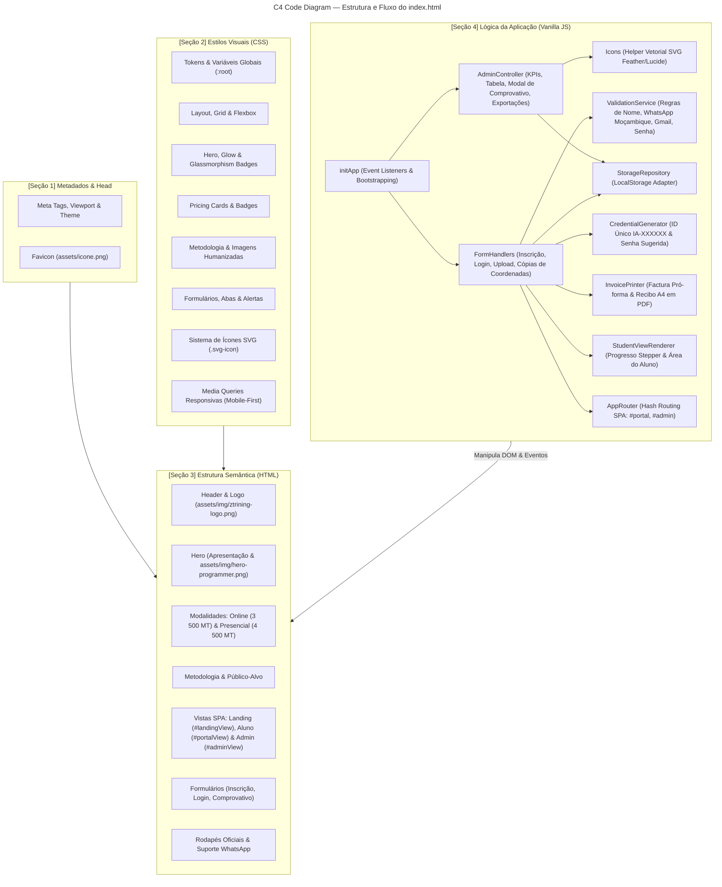

# ZEDECKS TRAINING — Programação Assistida por IA

[](https://inscricao.zedecks.com)
[-10b981?logo=github&style=flat-square)](https://inscricao.zedecks.com)
[](index.html)
[](LICENSE.md)

> **Landing Page oficial, Portal do Aluno & Painel Administrativo** para o curso *"Programação Assistida por IA — Do Zero ao Júnior"*.
>
> 🌐 **Acesso Online (Produção Oficial):** [https://inscricao.zedecks.com](https://inscricao.zedecks.com)

---

## 📌 Visão Geral do Projeto

Esta aplicação é uma solução *Single-File Clean Code* desenvolvida em tecnologias web nativas (**HTML5**, **CSS3** e **Vanilla JavaScript moderno**), sem dependência de frameworks externos ou bibliotecas pesadas.

O objetivo da plataforma é apresentar a proposta pedagógica do treinamento da **Zedecks Training** (Moçambique), captar inscrições para as modalidades **Online** e **Presencial**, emitir automaticamente **Facturas Pró-forma A4 em PDF**, e disponibilizar uma **Área do Aluno** interativa para envio de comprovativos e emissão de **Recibos de Quitação**, além de um **Painel de Controlo Administrativo** completo para validação de inscrições.

---

## 🏛️ C4 Code-Level Architecture

O arquivo principal [`index.html`](index.html) é estruturado de forma modular e desacoplada em 4 seções fundamentais:



---

## 📂 Organização Interna do [`index.html`](index.html)

| Bloco | Identificador | Responsabilidade |
| :--- | :--- | :--- |
| **1** | `<!-- [SEÇÃO 1] METADADOS -->` | Metatags SEO, tema, título e link para o ícone favicon. |
| **2** | `<!-- [SEÇÃO 2] ESTILOS (CSS) -->` | Design system com tokens HSL/Hex, microanimações, glassmorphism, responsividade e sistema de ícones `.svg-icon`. |
| **3** | `<!-- [SEÇÃO 3] ESTRUTURA (HTML) -->` | Marcação semântica com tags `header`, `main`, `section`, `form`, `footer`, tabelas de gestão e atributos de acessibilidade ARIA. |
| **4** | `<!-- [SEÇÃO 4] LÓGICA (JS) -->` | Módulo encapsulado (IIFE) com separação clara de responsabilidades (*Icons*, *Storage*, *Generators*, *Views*, *Handlers*, *Admin*). |

---

## ✨ Funcionalidades Principais

### 1. Sistema 100% Baseado em Ícones Vetoriais SVG
- Substituição total de emojis casuais por ícones vetoriais SVG nítidos e consistentes (estilo *Feather / Lucide*).
- Otimizados para qualquer densidade de pixels (Retina / 4K) e alinhados via `currentColor`.
- Helper central `Icons` em JavaScript para injeção dinâmica nas tabelas, feedbacks e modais.

### 2. Validações Estritas de Moçambique & UX
- **Nome Completo**: Auto-capitalização (Title Case), apenas caracteres alfabéticos latinos com acentos, sem números ou símbolos, espaço único entre palavras e até 52 caracteres.
- **WhatsApp / Telefone**: Exatamente 9 dígitos locais ou 13 se iniciado por `+258`, validando rigorosamente as operadoras moçambicanas (`82, 83, 84, 85, 86, 87, 88`).
- **E-mail**: Restrito exclusivamente a contas com domínio `@gmail.com`.
- **Perfil de Entrada**: Seleção direcionada para quem começa do Zero Absoluto, Iniciante ou Programador Tradicional querendo aliar IA.
- **Senha Híbrida**: O sistema sugere automaticamente uma senha alfanumérica segura com mínimo de 6 caracteres, permitindo edição livre pelo aluno.

### 3. Factura Pró-forma A4 & Recibo de Quitação
- **ID de Estudante Único**: Gerado na hora no padrão `IA-XXXXXX`, com verificação em tempo de execução para garantir unicidade.
- **Barra de Progresso (Stepper)**: 4 etapas dinâmicas (Inscrição Efetuada, Factura & Pagamento Pendente, Comprovativo Submetido, Vaga Confirmada).
- **Factura à Pagar Oficial**: Formatada em folha A4 com `@media print` para salvar direto como PDF de alta resolução pelo navegador (`window.print()`).
- **Cards de Pagamento Oficiais**: Coordenadas para M-Pesa (`+258 84 770 3309`), E-Mola (`+258 87 770 3308`) e Millennium BIM (NIB: `0001 0000 0038 5397 39457`), com botão de cópia com 1 clique.
- **Recibo de Quitação**: Disponível para download formal em A4 assim que a matrícula é validada pela coordenação.

### 4. Painel Executivo de Administração (`#admin` / `#gestao`)
- **Acesso Restrito**: Login protegido por senha mestre (`zedecks@admin`).
- **Métricas Analíticas em Tempo Real**: 4 cartões KPI com total de inscritos, receita total estimada em Meticais (MT), comprovativos em análise e vagas oficializadas.
- **Tabela de Candidatos**: Busca instantânea multicritério (Nome, ID, Telefone ou E-mail) e filtros de estado.
- **Auditoria Visual de Comprovativos**: Modal responsivo com pré-visualização de imagem real (JPG/PNG) ou documento PDF embutido enviado pelo candidato.
- **Aprovação, Reversão e Eliminação**:
  - *Validar & Aprovar Vaga* (confirmação imediata).
  - *Reverter / Rejeitar Comprovativo* (retorna status para análise ou pendente).
  - *Eliminar Inscrição* (remoção individual no lixeiro ou limpeza em lote com confirmação).
- **Relatório Oficial em PDF (A4)**: Emissão de relatório institucional formal com cabeçalho Zedecks Training, data/hora da extração, tabela discriminada e campo para assinatura da Coordenação Geral.
- **Exportação CSV**: Download da base de dados completa estruturada em planilha com acentuação corrigida via UTF-8 BOM.
- **Integração em Nuvem Híbrida**: Pronto para Firebase Firestore em tempo real (`FIREBASE_CONFIG`), operando nativamente em `localStorage` quando não configurado.

---

## 🌿 Estrutura de Branches & Fluxo de Desenvolvimento

O projeto adota a estratégia de branches com separação entre produção e desenvolvimento:

| Branch | Propósito | Deploy Automático |
| :--- | :--- | :--- |
| `main` | Código de produção estável | **GitHub Pages** via GitHub Actions |
| `development` | Ambiente de integração contínua e desenvolvimento ativo | Localhost / Testes |

### Ciclo de Trabalho Recomendado:
1. Todo o desenvolvimento novo, testes e correções devem ser realizados na branch **`development`**.
2. Após validação local e testes de integridade, mesclar para a branch **`main`**.
3. O envio para a `main` dispara automaticamente o workflow do **GitHub Actions** que atualiza a hospedagem no **GitHub Pages**.

---

## 🚀 Como Executar Localmente

### Pré-requisitos
Apenas um navegador web moderno e Python (ou Node.js) para servir os arquivos estáticos.

### Faixa de Portas Recomendada
Conforme as diretrizes de infraestrutura para projetos no `WaysPessoais`, a porta alocada é **`2025`**:

```bash
# Opção 1: Via npm
npm run dev

# Opção 2: Via Python diretamente
python -m http.server 2025
```

Acesse no navegador:
- **Página Principal:** [http://localhost:2025](http://localhost:2025)
- **Portal do Aluno:** [http://localhost:2025/#portal](http://localhost:2025/#portal)
- **Painel Administrativo:** [http://localhost:2025/#admin](http://localhost:2025/#admin)

---

## 🏷️ Configuração do "About" no Repositório GitHub

Para deixar o repositório oficial no GitHub com a apresentação profissional recomendada:

- **Description:**
  ```text
  ⚡ Landing page & Portal do Aluno com faturação pró-forma A4 em PDF e painel administrativo para o curso de Programação Assistida por IA — Zedecks Training.
  ```
- **Website URL:**
  ```text
  https://inscricao.zedecks.com
  ```
- **Topics (Tags):**
  `landing-page`, `student-portal`, `clean-code`, `vanilla-javascript`, `ai-coding`, `invoice-generator`, `admin-dashboard`, `github-pages`, `mozambique`

---

## 🛡️ Políticas de Contribuição e Licença

> [!IMPORTANT]
> **Este repositório NÃO aceita Pull Requests externos.**
> Por ser um projeto com design proprietário e regras de negócio específicas da **Zedecks Training**, qualquer Pull Request enviado será automaticamente recusado.

O código deste projeto é disponibilizado de forma aberta estritamente para **fins de consulta e auditoria técnica**. Consulte o arquivo [`LICENSE.md`](LICENSE.md) para os termos completos.

---

© 2026 **Zedecks Training** — Todos os direitos reservados.  
Dúvidas ou suporte: [WhatsApp +258 84 770 3309](https://wa.me/258847703309).
